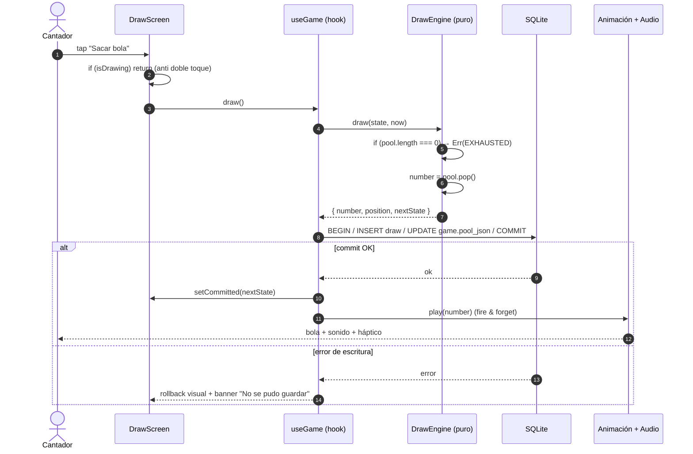
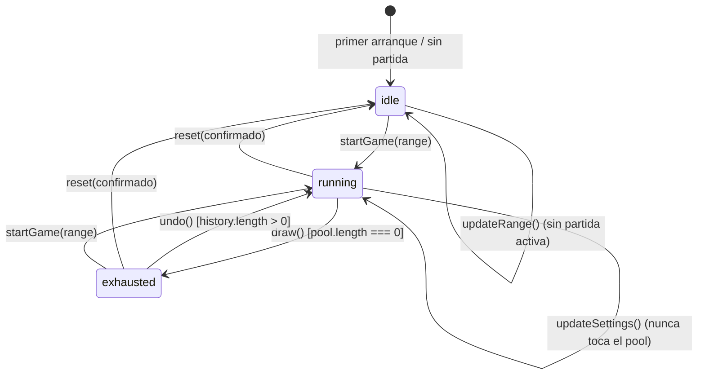
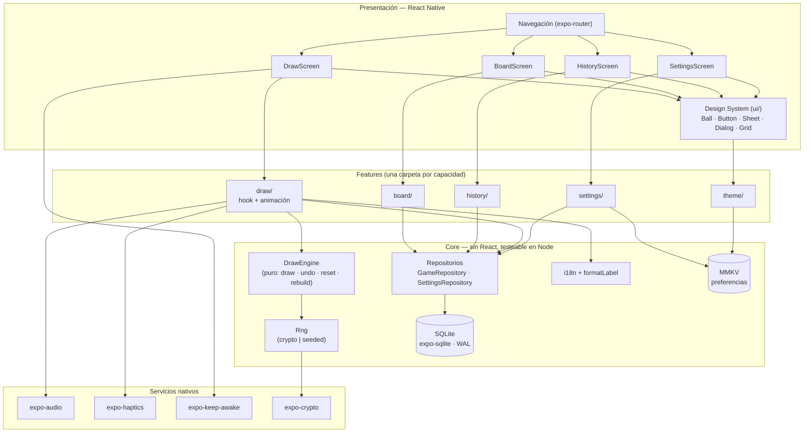
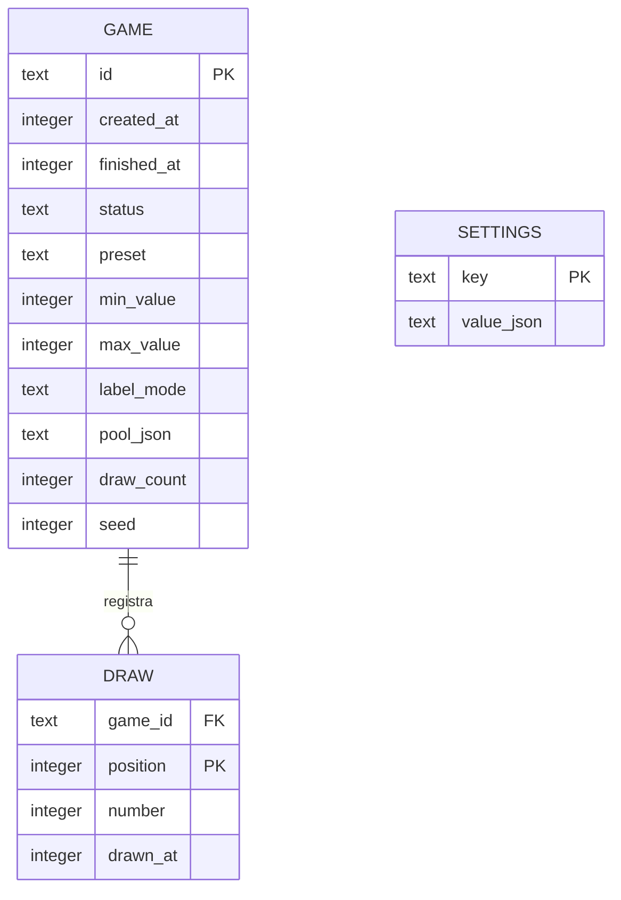
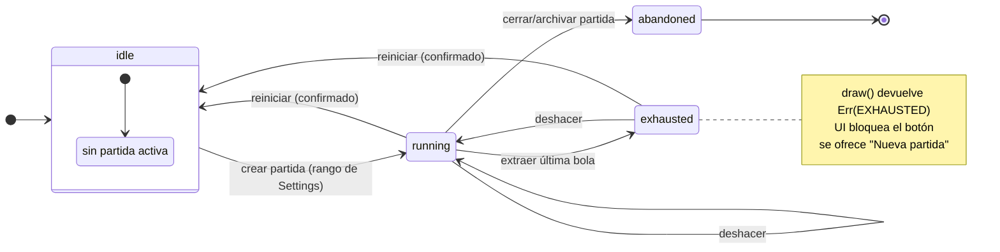
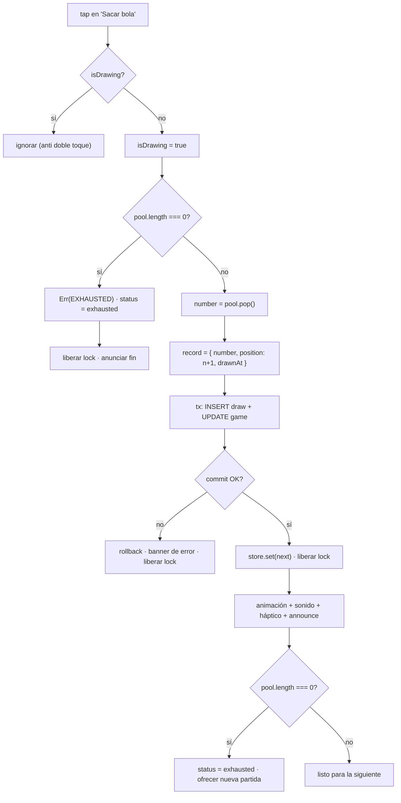
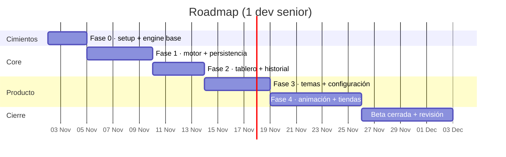

# Plan de Desarrollo — App Móvil de Sorteo de Bingo (Bombo Digital)

> Especificación técnica integral para construir una app móvil de extracción de bolas
> numeradas que reemplaza al bombo físico en partidas reales, **100 % offline y sin backend**.
> Cada sección es autónoma; los diagramas Mermaid se renderizan en GitHub, GitLab y la
> mayoría de editores Markdown.
>
> **Regla transversal:** la no repetición de números dentro de una partida es un
> **contrato inviolable**, no una funcionalidad. Cada decisión de este documento explica
> cómo la preserva (§2.9).

---

## 1. Visión del Producto y Alcance (MVP)

### 1.1 Propósito del sistema

Una **herramienta de sorteo** para personas que cantan bingo en un salón real: el
"cantador" proyecta o sostiene el teléfono, toca la pantalla y sale una bola. La app
sustituye el bombo de jaula, el bombo eléctrico y la libreta de tachado.

**Propuesta de valor:**

| Valor | Descripción |
|-------|-------------|
| **Cero fricción** | Se abre la app y se sortea. Sin cuenta, sin login, sin permisos, sin red. |
| **Confianza verificable** | El tablero y el historial muestran el universo completo y lo ya salido: cualquiera puede auditar que no se repite. |
| **Funciona donde no hay señal** | Salones con sótano, wifi saturada, roaming: irrelevante. La partida vive en el dispositivo. |
| **Se adapta al salón** | Presets 90/75/80 y rango libre; temas claro/oscuro/neón para proyector o ambiente con poca luz. |
| **Costo cero de operación** | Sin servidores, sin cuentas, sin suscripción. Instalás y usás. |

**Usuario primario:** cantador/organizador de bingo (50-70 años, poca tolerancia a la
complejidad, mucha necesidad de legibilidad a distancia).
**Usuario secundario:** jugador que quiere verificar el tablero.

### 1.2 Funcionalidades Core (MVP)

| Área | Funcionalidad |
|------|---------------|
| **Sorteo** | Extracción de **una bola por acción explícita** del usuario, con animación y sonido sincronizados. |
| **Registro** | Bola actual en primer plano + contador `X de Y` + historial cronológico inverso + tablero completo del rango con extraídas/pendientes. |
| **Reinicio** | Nueva partida con **confirmación explícita** (destructiva, muestra cuántas extracciones se pierden). |
| **Deshacer** | Revertir la última extracción devolviendo la bola al pool (una o varias veces, ver §2.6). |
| **Configuración de rango** | Presets 90/75/80 + modo personalizado con validación y vista previa del total. |
| **Configuración visual y sensorial** | 4 temas, claro/oscuro/automático, sonido, hápticos, velocidad de animación, reducir movimiento. |
| **Persistencia** | Estado de partida y preferencias sobreviven cierre, muerte del proceso y reinicio del dispositivo. |
| **Offline total** | Sin red, sin backend, sin telemetría. La app no pide permiso de internet. |

### 1.3 Fuera de alcance (v1)

- Multijugador, sincronización entre dispositivos, sala compartida.
- Cartones digitales, validación de línea/bingo, premios.
- Compra integrada, cuentas, nube, analytics, anuncios.
- Voz sintética que cante la bola (candidato v1.1; ver §11.3).
- Modo automático con temporizador (rompe "una bola por acción del usuario").

### 1.4 Criterios de éxito del MVP

- 100 % de las partidas de prueba (10 000 iteraciones) sin duplicados ni huecos.
- Extracción percibida como instantánea: feedback visual/sonoro < 100 ms desde el tap.
- Animación a 60 fps estables en un Android gama media de 2021.
- Recuperación exacta del estado tras `force-stop` y reinicio del dispositivo.
- Publicado en Google Play (producción) y App Store (producción).

---

## 2. Regla de Negocio Crítica: Sorteo Sin Repetición

Esta sección es el **contrato del motor**. Todo lo demás (UI, temas, navegación) es
reemplazable; esto no.

### 2.1 Invariante principal

> **INV-1.** Dentro de una partida, cada número del rango configurado se extrae **como
> máximo una vez**. La repetición solo es posible tras iniciar una partida nueva.

Formalmente, para una partida con rango `[min, max]` y `n` extracciones realizadas:

```
1. |history| = n
2. ∀ i < j ≤ n : history[i].number ≠ history[j].number        (sin repetición)
3. ∀ d ∈ history : min ≤ d.number ≤ max                        (subset del rango)
4. pool ∪ {history.number} = {min..max}  ∧  pool ∩ history = ∅  (partición exacta)
5. |pool| + n = max - min + 1                                   (conservación)
6. history[i].position = i + 1                                  (monotonía)
```

`INV-1` se verifica en **cuatro capas independientes** (§2.9); ninguna decisión de
diseño puede debilitar alguna de ellas.

### 2.2 Algoritmo recomendado: Fisher-Yates + consumo por el final

Al iniciar la partida:

1. Se materializa el rango completo en un array `pool = [min, min+1, …, max]`.
2. Se aplica **Fisher-Yates** (`for i = pool.length-1 … 1: j = randInt(i+1); swap(i, j)`).
3. Cada extracción es `pool.pop()`: **O(1)**, sin rechazos, sin bucles de reintento.

```ts
// core/engine/shuffle.ts
export type Rng = () => number; // [0, 1)

export function shuffle<T>(input: readonly T[], rng: Rng): T[] {
  const a = input.slice();
  for (let i = a.length - 1; i > 0; i--) {
    const j = Math.floor(rng() * (i + 1)); // ver randomInt() sin sesgo en §2.8
    [a[i], a[j]] = [a[j], a[i]];
  }
  return a; // se consume con pop(): el último elemento sale primero
}
```

**Por qué este y no otro:**

| Criterio | Fisher-Yates + `pop()` |
|----------|------------------------|
| Complejidad por extracción | **O(1)** garantizado (amortizado O(n) una vez al inicio) |
| Latencia | **Plana y predecible** → la animación siempre dura lo mismo |
| Estado derivado | Ninguno: el pool *es* la verdad, no hay que consultar nada más |
| Repetición | **Imposible por construcción**: el elemento se extrae del array |
| Memoria | 90 enteros ≈ 360 B. Irrelevante |

### 2.3 Alternativas evaluadas y tradeoffs

**A. Muestreo con rechazo** (`n = randInt(min, max)`; si `n ∈ extraídos`, reintentar)

- ✅ Implementación de 3 líneas; no necesita array.
- ❌ **Degenera al final del rango**: con 89 de 90 bolas fuera, la esperanza de
  intentos es 90 y la cola es geométrica → *latencia impredecible* justo en el momento
  más visible de la partida (últimas bolas). Eso rompe la animación: no se puede saber
  cuánto tardará el sorteo, y el usuario percibe "se trabó".
- ❌ Requiere `Set` de extraídos de todos modos → es el peor de ambos mundos.
- **Veredicto:** descartado.

**B. `Set` de extraídos como fuente de verdad** (`while (set.size < n) …`)

- ✅ Simple y correcto; O(1) promedio por extracción.
- ❌ Contradice el requisito de persistir el *pool pendiente*: el pool pasa a ser estado
  derivado (`rango − set`), con dos fuentes de verdad que pueden divergir tras un crash.
  Cada lectura del pool es O(n).
- ❌ El orden de extracción no queda definido → no hay modo reproducible.
- **Veredicto:** descartado como fuente de verdad. Se usa **solo como verificación** en
  tests de propiedad (`new Set(history) === history.length`).

**C. Fisher-Yates con semilla persistida como única verdad** (`seed + drawCount`)

- ✅ Estado mínimo (2 números) y reproducible por construcción.
- ❌ **Frágil**: si el PRNG no es bit-a-bit idéntico entre plataformas o versiones de
  runtime, el estado se corrompe de forma silenciosa. Un cambio de Hermes/JSC puede
  convertir partidas guardadas en secuencias distintas.
- **Veredicto:** descartado como verdad primaria. Se usa **solo** para modo
  reproducible en dev/demos (§2.8), donde la semilla *y* el pool se persisten.

**D. Tabla de bolas agotadas en base de datos con `SELECT … ORDER BY random() LIMIT 1`**

- ✅ Una sola consulta.
- ❌ O(n) por extracción, no determinista en orden, imposible de testear sin DB, y el
  coste crece con el rango. Sobre-ingeniería para 90 elementos.
- **Veredicto:** descartado.

### 2.4 Fin de partida

Cuando `pool.length === 0`:

- El motor devuelve `Exhausted`; la extracción queda **bloqueada** en el dominio (no en
  la UI: la UI solo refleja).
- Estado `exhausted`: la pantalla de sorteo muestra "Partida completa — 90 de 90",
  deshabilita el botón principal y ofrece **"Nueva partida"** como acción primaria.
- Se registra `finished_at` y la partida pasa a histórico (no se borra sola).
- `undo` sigue permitido en `exhausted` (devuelve la última bola y la partida vuelve a
  `running`) — necesario para el caso real "me equivoqué en la última".

### 2.5 Persistencia

**Qué se guarda:** el pool pendiente **con su orden** y el log de extracciones.

**Regla de oro — commit antes de animar:** la extracción se persiste *antes* de que
empiece la animación. Si el proceso muere a mitad de la animación, la bola ya está
contabilizada y la app reabre mostrándola. El orden inverso (animar y luego guardar)
abriría una ventana donde la UI muestra una bola que el estado no conoce → el usuario
reintenta → duplicado. *Esta es la decisión que más protege `INV-1` en producción.*

**Atomicidad:** `INSERT draw` + `UPDATE game.pool_json` en **una sola transacción**
(§5.4). O se aplican ambos o ninguno.

**Recuperación tras corrupción:** al cargar, el chequeo de integridad (§2.9, capa 4)
reconstruye el pool desde el historial (que es la verdad *visible* para el usuario) con
un nuevo shuffle de los números restantes. Preferimos perder el *orden* a duplicar un
número.

### 2.6 Deshacer

- Semántica: `undo` elimina la última entrada del historial y **devuelve el número al
  final del pool** (`pool.push(n)`).
- Devolverlo al final (no a una posición aleatoria) implica que **la próxima extracción
  devuelve exactamente la misma bola** → deshacer es una operación reversible real, y
  se puede rehacer sacando otra vez.
- Límite: `undo` deshace **una** extracción por pulsación, repetible hasta el inicio de
  la partida. No hay "deshacer todo" (eso es `reset`, con confirmación).
- `undo` en `exhausted` reactiva la partida (`exhausted → running`).
- `undo` nunca viola `INV-1`: el número vuelve a estar en el pool y deja de estar en el
  historial, en la misma transacción.



> El diagrama muestra el orden deliberado: **motor → persistencia → animación**. La
> animación es presentación de un hecho ya consumado, nunca la causa de él.

### 2.7 Modelo de la partida (máquina de estados)



| Estado | `draw` | `undo` | `reset` | `updateRange` | `updateSettings` |
|--------|--------|--------|---------|---------------|------------------|
| `idle` | ✗ | ✗ | ✗ | ✓ | ✓ |
| `running` | ✓ | ✓ (si hay historial) | ✓ (con confirmación) | ✗ → requiere reinicio | ✓ |
| `exhausted` | ✗ (bloqueado) | ✓ | ✓ (con confirmación) | ✗ → requiere reinicio | ✓ |

**Acciones ilegales no se ignoran en silencio:** el motor devuelve un `Result` con error
tipado (`EXHAUSTED`, `EMPTY_HISTORY`, `RANGE_LOCKED`) y la UI muestra el motivo.

### 2.8 Aleatoriedad

**Modo normal (producción):** `expo-crypto.getRandomValues()` (CSPRNG del sistema:
`SecRandomCopyBytes` / `java.security.SecureRandom`), con **muestreo por rechazo para
eliminar el sesgo de módulo**:

```ts
// core/engine/rng.ts
import { getRandomValues } from 'expo-crypto'; // WebCrypto no existe en Hermes

export function cryptoRng(): Rng {
  const buf = new Uint32Array(1);
  return () => {
    getRandomValues(buf);
    return buf[0] / 0x1_0000_0000; // uniforme en [0,1)
  };
}
```

Para `randInt(k)` se usa rechazo sobre 32 bits (descartar valores ≥ `⌊2^32/k⌋·k`) — no
`% k`. Con 90 bolas el sesgo es despreciable, pero el costo de hacerlo bien es de tres
líneas y el resultado es *demostrablemente* uniforme.

| Opción | Tradeoff |
|--------|----------|
| `Math.random()` | Rápido, pero no criptográfico y **no auditable**; en Hermes es xorshift sembrado al arranque. Inaceptable para un sorteo. |
| CSPRNG (`expo-crypto`) | Uniforme y no predecible. Coste ~µs; irrelevante frente a una animación de 400 ms. **Elegido.** |
| PRNG sembrado (`mulberry32`) | Reproducible, no seguro. Solo para tests y demos. |

**Modo reproducible (solo `__DEV__` y build de demo):** PRNG `mulberry32(seed)` con
semilla explícita. La semilla se muestra en un panel de diagnóstico y se puede fijar por
parámetro. **Nunca se expone en builds de producción**: un sorteo con semilla conocida
deja de ser un sorteo justo, y eso es un riesgo reputacional (y de políticas de tienda,
ver §9.4).

### 2.9 Cómo cada decisión preserva la invariante

| # | Decisión | Capa | Cómo protege `INV-1` |
|---|----------|------|----------------------|
| 1 | Fisher-Yates + `pop()` | Motor | El número extraído **abandona** el array: no puede volver a salir sin un `push` explícito. La no repetición es estructural, no defensiva. |
| 2 | Motor puro + escritor único | Dominio | `draw`/`undo` son funciones puras; la UI no puede mutar el pool. No hay "segundo camino" para crear una extracción. |
| 3 | Lock `isDrawing` + botón deshabilitado | UI | Un doble toque no produce dos extracciones; el segundo tap es un no-op. |
| 4 | Commit antes de animar | Persistencia | Un crash a mitad de animación no pierde ni duplica: el estado ya es consistente. |
| 5 | Transacción única `draw`+`pool` | Persistencia | No existe un instante con el historial actualizado y el pool sin actualizar. |
| 6 | `UNIQUE (game_id, number)` en SQLite | Storage | Incluso un bug de código no puede insertar el mismo número dos veces: la BD rechaza. |
| 7 | `CHECK (position = draw_count + 1)` lógico + PK `(game_id, position)` | Storage | Impide historial no monótono o huecos silenciosos. |
| 8 | Chequeo de integridad al cargar | Arranque | Un archivo corrupto o editado a mano se detecta y se repara desde el historial, sin duplicar. |
| 9 | Rango bloqueado con partida en curso | Config | Cambiar `[min,max]` invalidaría la partición `pool ∪ history = rango`; por eso solo aplica a partidas nuevas. |
| 10 | `undo` = `push` al final | Motor | Revierte exactamente el último paso; el número vuelve al pool y sale del historial en la misma transacción. |

---

## 3. Configuración del Rango de Números

### 3.1 Presets

| Preset | Rango | Total | Etiqueta | Cuadrícula del tablero |
|--------|-------|-------|----------|------------------------|
| **Bingo europeo** | 1–90 | 90 | solo número | 9 filas × 10 columnas |
| **Bingo americano** | 1–75 | 75 | `B-I-N-G-O` + número | 5 columnas (B/I/N/G/O) × 15 filas |
| **80 bolas** | 1–80 | 80 | solo número | 8 × 10 |
| **Personalizado** | `min`–`max` | `max-min+1` | solo número | columnas adaptativas |

Mapeo de letras para 75: `B: 1-15 · I: 16-30 · N: 31-45 · G: 46-60 · O: 61-75`.
La etiqueta se calcula en el dominio (`formatLabel(n, preset)`), no en la UI, para que
historial, tablero y bola usen exactamente la misma función.

### 3.2 Rango personalizado — validación

| Regla | Mensaje |
|-------|---------|
| `min` y `max` enteros | "Usá números enteros." |
| `1 ≤ min < max` | "El mínimo debe ser menor que el máximo." |
| `min ≥ 1` | "El rango empieza en 1 como mínimo." |
| `max ≤ 200` (v1) | "Por ahora el máximo es 200 bolas." |
| `total = max-min+1` | Se muestra siempre, en vivo: "**Serán 64 bolas**". |
| `total < 10` | Advertencia no bloqueante (ámbar): "Un rango tan corto termina la partida en 10 extracciones." |
| Sin huecos | Por construcción: el rango es contiguo `[min..max]`. No se admiten listas arbitrarias en v1. |

**Por qué 200 y no 999:** el tablero debe ser legible y accesible. Por encima de ~200
celdas, cada celda queda por debajo del mínimo táctil de 44 pt en un teléfono de 6", y
la grilla necesita renderizado en canvas (Skia) con nodos de accesibilidad virtuales.
Ese es un problema de v1.2, no del MVP (§11.3). El límite es una **constante de dominio**
(`RANGE_MAX_TOTAL`), no un número escondido en la UI.

### 3.3 Aplicación de cambios

- **Sin partida activa (`idle`):** el cambio aplica de inmediato.
- **Con partida en curso (`running` / `exhausted`):** el formulario se puede editar, pero
  al confirmar aparece un diálogo:

  > **Cambiar el rango reinicia la partida**
  > Vas a pasar de 90 a 64 bolas. Se perderán las **23** extracciones de la partida actual.
  > `[Cancelar]` `[Reiniciar y aplicar]`

  Nunca se aplica un rango a una partida en curso: rompería la partición de `INV-1` y
  dejaría bolas "fantasma" fuera del nuevo universo.
- **Persistencia:** el rango elegido se guarda como **preferencia** (para la próxima
  partida) *y* se materializa en la partida al crearla. Son dos campos distintos: el
  rango de la partida es inmutable una vez creada.

### 3.4 Etiquetado

`labelMode: 'number' | 'letter-number'`. Solo `letter-number` tiene efecto real en el
preset 75; en el resto se muestra el número. La preferencia se respeta también en
tablero e historial (consistencia visual) y se anuncia por lector de pantalla como
"B, doce" en lugar de "B-12".

---

## 4. Configuración de Estilo (Tematización)

### 4.1 Arquitectura de temas: tokens, no código

Un tema es un **objeto de tokens validado por Zod**. No hay `if (theme === 'neon')`
disperso por los componentes: hay un `ThemeProvider` que expone tokens tipados y un
renderizador de bola (`<BallView>`) que los consume.

```ts
// features/theme/tokens.ts
export type ThemeTokens = {
  id: 'classic' | 'minimal' | 'neon' | 'festive';
  scheme: 'light' | 'dark';
  colors: {
    bg: string; surface: string; felt: string;
    ballFrom: string; ballTo: string; ballText: string; ballRing: string;
    text: string; textMuted: string; accent: string; border: string;
    drawn: string; pending: string; danger: string;
  };
  ball: {
    radius: number;            // 0 = cuadrada, 0.5 = círculo perfecto
    texture: 'none' | 'noise' | 'felt';
    ringWidth: number;
    shadow: 'none' | 'soft' | 'hard';
  };
  typography: {
    displayFamily: string;     // fuente empaquetada (ver §4.6)
    displayWeight: '600' | '700' | '800';
    tabularFigures: true;      // crítico: evita el "salto" de ancho entre 1 y 8
  };
  motion: {
    drawDurationMs: number;    // base; se multiplica por animationSpeed
    ease: 'outBack' | 'outCubic' | 'linear';
  };
};
```

### 4.2 Temas predefinidos

| Tema | Scheme | Idea visual | Uso real |
|------|--------|-------------|----------|
| **Clásico** | light | Madera cálida, fieltro verde, bola crema con brillo especular | Salón tradicional, luz cálida |
| **Minimalista** | light/dark | Fondo casi blanco/negro, bola plana, tipografía enorme, cero textura | Proyector, máxima legibilidad |
| **Neón** | dark | Fondo negro azulado, bola con glow cian/magenta, alto contraste | Salas con poca luz, eventos nocturnos |
| **Festivo** | light | Confeti estático, paleta saturada, radios grandes | Fiestas, bingos familiares |

Cada tema declara **ambas** variantes (`light` y `dark`) en la tabla de tokens; el modo
`auto` elige según `useColorScheme()`. **No** se inventa una variante oscura en runtime
invirtiendo colores: el contraste se valida por tema y por modo (§4.5).

### 4.3 Tokens ajustables por el usuario

El MVP **no** expone un editor libre de tokens (sería un producto distinto). Expone:

- Selección de tema (4 opciones, previsualización en vivo en una bola de muestra).
- `appearance`: claro / oscuro / automático.
- Tamaño del número: `normal` / `grande` / `extra` (multiplicador 1.0 / 1.25 / 1.5 sobre
  la tipografía display) — resuelve el caso real "lo veo desde el fondo del salón".
- `labelMode` (número vs. letra+número).

El contrato de tokens queda listo para un futuro "tema personalizado" (v1.2) sin
reescribir componentes: bastaría persistir un `ThemeTokens` validado en lugar del `id`.

### 4.4 Feedback sensorial

| Ajuste | Valores | Notas de implementación |
|--------|---------|-------------------------|
| `sound` | on/off + volumen | `expo-audio` con el clip **precargado** al montar la pantalla. Disparar en el mismo frame del tap, no al final de la animación. |
| `haptics` | on/off | `expo-haptics.impactAsync(Medium)` en el tap; `notificationAsync(Success)` al agotar el pool. En iOS los patrones son fijos; no prometer vibración personalizada. |
| `animationSpeed` | 0.5× / 1× / 1.5× | Multiplica `tokens.motion.drawDurationMs`. **No** cambia la lógica: el estado se commitea igual. |
| `reduceMotion` | on/off/auto | `auto` lee `AccessibilityInfo.isReduceMotionEnabled()` y escucha cambios. Con `reduceMotion`: duración 0 + cross-fade de 120 ms + anuncio accesible. |
| `keepAwake` | on/off (default on) | `expo-keep-awake` activo solo en la pantalla de sorteo con partida `running`. |

**Regla:** audio y hápticos son *fire-and-forget*. Si el audio falla al cargar (archivo
corrupto, modo silencioso), se desactiva el ajuste y se muestra un aviso discreto; nunca
bloquea el sorteo.

### 4.5 Accesibilidad

- **Contraste:** mínimo **AA** (4.5:1 texto, 3:1 elementos gráficos) verificado por un
  test automático que recorre todos los pares tema×modo (§8.4). Un tema que no pasa no
  entra al bundle.
- **Escalado de texto:** `allowFontScaling` activo en todo el texto; layouts con
  `flexShrink`/`numberOfLines` acotado y sin alturas fijas. Probado a 200 % de escala.
- **Lectores de pantalla:** `accessibilityLabel` en cada celda del tablero
  ("Número 42, extraído"), `accessibilityState={{ selected }}`, y
  `AccessibilityInfo.announceForAccessibility("Bola 42. Quedan 48.")` tras cada
  extracción. El botón principal expone `accessibilityHint` cuando está bloqueado
  ("La partida terminó. Iniciá una nueva partida.").
- **Sin animación:** alternativa completa (bola aparece con fade + anuncio). Nunca la
  información *solo* por animación.
- **Objetivos táctiles:** ≥ 44×44 pt. En el tablero de 90, celdas de 48 pt con 6 pt de
  separación (entra en 6.1" con scroll).
- **`accessibilityRole`** correcto: botones son `button`, celdas del tablero `gridcell`
  dentro de un contenedor `grid`.

### 4.6 Tipografía

- 2 familias empaquetadas (`expo-font`, licencia OFL): una **display** con figuras
  tabulares para la bola un display y una **UI** para el resto. Sin descargas en runtime
  (offline).
- `tabularFigures: true` es no negociable en el número de la bola: con figuras
  proporcionales, el número "salta" de ancho al cambiar de 1 a 8 y la animación vibra.

### 4.7 Persistencia de preferencias

Independiente del estado de partida, en almacenamiento clave-valor (§5.4). Claves
versionadas: `settings.v1`. Un `Settings` corrupto **nunca** bloquea el arranque: se
parsea con Zod y cada campo inválido cae a su default individual (`.catch()`), no al
objeto entero.

---

## 5. Arquitectura Multiplataforma y Stack

### 5.1 Framework: **React Native + Expo (TypeScript)** — decisión y justificación

**Elegido: Expo SDK 54 + React Native 0.81 + TypeScript estricto.**

| Criterio | React Native + Expo | Flutter | Veredicto |
|----------|---------------------|---------|-----------|
| **Animaciones 60 fps** | Reanimated 3 (worklets en UI thread) + Skia: transformaciones y shaders sin cruzar el bridge. | Impeller es excelente y muy predecible. | **Empate técnico.** Ambos llegan a 60 fps de sobra para una bola. Flutter tiene menos "sorpresas" de rendimiento; RN exige disciplina (nunca animar `width/height` desde JS). |
| **Ecosistema** | npm: `expo-audio`, `expo-haptics`, `expo-sqlite`, `expo-keep-awake`, `expo-crypto`, `react-native-mmkv`. Todo lo que necesitamos existe y está mantenido. | pub.dev cubre lo mismo con calidad similar. | Empate. |
| **Publicación** | **EAS Build compila iOS en la nube: no hace falta un Mac.** EAS Submit + EAS Update. | Codemagic/Xcode Cloud; también sin Mac, pero con más configuración manual. | **Ventaja RN/Expo** para un equipo sin Mac. |
| **Curva de entrada** | TypeScript + React. El equipo ya trabaja en TS (ver plan-github, plan-tasks-app). | Dart desde cero. | **Ventaja RN** decisiva en este contexto. |
| **Hilos / concurrencia** | JS single-thread: la lógica es trivial (un `pop()`), y la animación vive en el UI thread. Sin riesgo. | Isolates, más potencia innecesaria aquí. | Empate. |
| **Riesgo de upgrade** | Expo SDK anual con breaking changes; RN 0.8x mueve cosas (New Architecture). | Flutter es más estable en upgrades. | **Ventaja Flutter**, mitigada fijando el SDK y actualizando una vez por release, no en caliente. |
| **Tamaño de binario** | ~25-35 MB (Hermes). | ~20 MB. | Irrelevante. |

**Justificación en una frase:** el problema técnico difícil *no* es el rendimiento
gráfico (una bola y una grilla), es la **corrección del estado persistido**; y para eso
queremos el lenguaje y el ecosistema donde el equipo ya es productivo, más la única
cadena de publicación que no exige hardware Apple.

**Consecuencia honesta:** Skia y MMKV **no están en Expo Go**. El proyecto usa
`expo-dev-client` y builds de desarrollo desde el día 1. No es un problema, pero hay que
decirlo antes de empezar (y está en la Fase 0 del roadmap).

### 5.2 Diagrama de arquitectura



**Principio rector:** `core/` no importa `react`, `react-native` ni `expo-*` (salvo los
puertos inyectados). Eso permite testear el motor en Node puro, sin emulador, en
milisegundos (§8.1).

### 5.3 Capa de UI y animaciones

**Stack de animación:**

| Necesidad | Herramienta | Por qué |
|-----------|-------------|---------|
| Salida de la bola, escala, rebote | **Reanimated 3** (worklets) | Corre en el UI thread; un GC de JS no rompe el frame. |
| Bola con degradado radial, brillo especular, ruido/fieltro | **@shopify/react-native-skia** | Un solo `Canvas` con shaders; la textura es un shader, no 4 imágenes. |
| Transiciones entre pantallas | Reanimated + `expo-router` | Sin dependencia extra. |
| Confeti del tema festivo | Skia (partículas) o Lottie | Skia evita un runtime más. |

**Descartado explícitamente:**

- **Rive**: produce animaciones espectaculares, pero introduce un pipeline de assets y
  un runtime más para *una* animación. Si el diseño pide una bola "3D" compleja, Rive es
  la salida, no el punto de partida. *(Tradeoff: menos control artístico, menos superficie de error.)*
- **Lottie para la bola**: pesa más que el shader y no se puede tematizar por tokens.
- **`Animated` (legacy)**: no corre en el UI thread; descartado.

**Reglas de rendimiento (no negociables):**

1. Animar solo `transform` y `opacity`; nunca `width/height/top/left`.
2. La animación se define como una función del estado ya commiteado; es *seekable* y
   cancela limpio al desmontar.
3. Presupuesto: tap → primer frame de animación < 16 ms; animación completa 400 ms base.
4. Medir con el profiler de RN + `React DevTools` en un dispositivo gama media real
   (no en emulador, no en un flagship).

### 5.4 Estado: separación partida / preferencias

| Dimensión | Naturaleza | Dónde vive | Herramienta |
|-----------|------------|------------|-------------|
| **Partida** | Efímera en memoria, **persistida** de forma transaccional, con invariantes | SQLite | `expo-sqlite` + transacciones |
| **Preferencias** | Pequeña, de lectura ubicua, sin invariantes | Clave-valor | `react-native-mmkv` |
| **UI transitoria** | `isDrawing`, sheet abierto, error de toast | Memoria | `useState` local |

- **Zustand** para el store de partida en memoria (`gameStore`): suscripción granular,
  sin providers, y el estado es un espejo tipado de lo persistido.
- **No** se usa el `persist` middleware de Zustand para la partida: reescribe el blob
  completo y no ofrece transacciones. La partida se guarda explícitamente en el
  repositorio, con SQL.
- **Única fuente de verdad:** el motor + la DB. El store es una caché de lectura; toda
  mutación pasa por `GameRepository`, que es el único autorizado a escribir.

```
UI action → store.dispatch → engine (puro) → repository.save(tx) → store.set(state)
```

### 5.5 Esquema de persistencia y migraciones

```sql
-- v1 — esquema inicial
PRAGMA journal_mode = WAL;
PRAGMA foreign_keys = ON;

CREATE TABLE game (
  id            TEXT PRIMARY KEY,
  created_at    INTEGER NOT NULL,
  finished_at   INTEGER,
  status        TEXT    NOT NULL CHECK (status IN ('running','exhausted','abandoned')),
  preset        TEXT    NOT NULL CHECK (preset IN ('eu90','us75','n80','custom')),
  min_value     INTEGER NOT NULL,
  max_value     INTEGER NOT NULL,
  label_mode    TEXT    NOT NULL CHECK (label_mode IN ('number','letter-number')),
  pool_json     TEXT    NOT NULL,   -- orden restante: pool[0] es la próxima bola
  draw_count    INTEGER NOT NULL DEFAULT 0,
  seed          INTEGER,            -- solo modo reproducible
  CHECK (min_value < max_value),
  CHECK (draw_count >= 0)
);

-- Solo puede existir una partida activa a la vez
CREATE UNIQUE INDEX ux_game_active ON game(status) WHERE status = 'running';

CREATE TABLE draw (
  game_id   TEXT    NOT NULL REFERENCES game(id) ON DELETE CASCADE,
  position  INTEGER NOT NULL,   -- 1..n
  number    INTEGER NOT NULL,
  drawn_at  INTEGER NOT NULL,
  PRIMARY KEY (game_id, position),
  UNIQUE (game_id, number)      -- INV-1 aplicada por el storage
);

CREATE INDEX ix_draw_game_time ON draw(game_id, drawn_at);
```

**Migraciones:** archivos SQL numerados (`001_init.sql`, `002_…`) aplicados en una
transacción, con `PRAGMA user_version` como marcador. Antes de migrar, se copia el
archivo `.db` a `game.db.bak-<version>`; si la migración falla, se restaura el backup y
la app arranca en **modo seguro** (solo lectura + botón "exportar partida"). Nunca se
borran datos del usuario para "arreglar" un esquema.

**Preferencias:** `settings.v1` en MMKV, JSON validado por Zod con *defaults* por campo y
`settingsVersion` embebido. Migrar = leer `v1`, transformar en memoria, escribir `v2`.

### 5.6 Sin backend: modelo local-first

**Justificación:**

- **Latencia:** el requisito es feedback inmediato; una ida y vuelta de red introduce
  entre 80 y 800 ms de varianza. La red es el enemigo de la UX aquí.
- **Disponibilidad:** el escenario de uso es un salón, frecuentemente sin buena señal.
- **Privacidad:** no hay cuentas ni datos personales que proteger → el formulario de
  *data safety* de Play es "no se recogen datos", verificable porque la app no pide
  permiso de INTERNET (§9.3).
- **Costo:** cero infraestructura, cero ops, cero superficie de ataque.

**Qué se necesitaría para añadir sincronización (diseño preparado, no implementado):**

1. El log de `draw` ya es un **log de eventos append-only** con `position` monótona →
   es la base de un CRDT trivial (o de un servidor autoritativo que reciba el log).
2. Añadir `device_id` y `game_id` global (UUID v4, ya generado localmente).
3. Resolución de conflicto: por `(game_id, position)` con `UNIQUE` → el servidor rechaza
   duplicados y el cliente re-sincroniza. `INV-1` se mantiene igual.
4. Transporte: HTTPS + cola offline (outbox). Requiere permiso de INTERNET → hay que
   asumir el costo de privacidad y actualizar las declaraciones de tienda.

> **Decisión:** no se construye nada de esto en v1, pero el modelo de datos no lo impide.
> Esa es la diferencia entre "sin backend" y "sin arquitectura".

### 5.7 Estructura de carpetas (feature-based)

```
bingo/
├─ app/                          # expo-router: solo rutas y providers
│  ├─ _layout.tsx                # ThemeProvider, I18nProvider, DB bootstrap
│  ├─ (tabs)/
│  │  ├─ _layout.tsx             # tab bar: Sorteo · Tablero · Historial · Ajustes
│  │  ├─ index.tsx               # DrawScreen
│  │  ├─ board.tsx
│  │  ├─ history.tsx
│  │  └─ settings.tsx
│  └─ +not-found.tsx
├─ src/
│  ├─ core/                      # 0 dependencias de React
│  │  ├─ engine/
│  │  │  ├─ types.ts             # EngineState, DrawRecord, Result, errors
│  │  │  ├─ shuffle.ts           # fisherYates + randInt sin sesgo
│  │  │  ├─ rng.ts               # cryptoRng · mulberry32
│  │  │  ├─ game.ts              # createGame · draw · undo · reset · integrityCheck
│  │  │  ├─ range.ts             # presets, validación, total, formatLabel
│  │  │  └─ __tests__/           # unit + property (fast-check)
│  │  ├─ db/
│  │  │  ├─ client.ts            # open, WAL, PRAGMAs
│  │  │  ├─ migrations/
│  │  │  │  ├─ 001_init.sql
│  │  │  │  └─ index.ts
│  │  │  └─ repositories/
│  │  │     ├─ game.repository.ts
│  │  │     └─ settings.repository.ts
│  │  ├─ i18n/                   # i18next + locales/es.json, en.json
│  │  └─ result.ts               # ok/err helpers
│  ├─ features/
│  │  ├─ draw/                   # components/, hooks/, DrawScreen
│  │  ├─ board/
│  │  ├─ history/
│  │  ├─ settings/
│  │  └─ theme/                  # tokens, 4 temas, ThemeProvider, useTheme
│  ├─ ui/                        # primitivas: Ball, Button, Grid, Dialog, Sheet
│  └─ shared/                    # utils sin dominio (time, array, contrast)
├─ assets/
│  ├─ fonts/                     # display + ui (OFL)
│  ├─ audio/                     # draw.m4a, win.m4a
│  └─ images/                    # icon, splash, adaptive-icon, favicon
├─ e2e/                          # Maestro flows (.yaml)
├─ app.config.ts                 # expo config dinámico (perfiles EAS)
├─ eas.json
└─ tsconfig.json                 # strict: true, paths: @/* → src/*
```

**Por qué feature-based:** `features/draw/` contiene su componente, su hook, sus tests y
sus strings. Cuando el MVP crezca, se borra o se reescribe una feature sin tocar las
otras. Una carpeta `components/` con 40 archivos y `hooks/` con 20 es exactamente el
antipatrón que este proyecto evita.

---

## 6. Modelo de Datos y Máquina de Estados

### 6.1 Entidades

```ts
// core/engine/types.ts
export type RangePreset = 'eu90' | 'us75' | 'n80' | 'custom';

export type RangeConfig = {
  preset: RangePreset;
  min: number;
  max: number;
  labelMode: 'number' | 'letter-number';
};

export type DrawRecord = {
  number: number;
  position: number;   // 1-based
  drawnAt: number;    // epoch ms
};

export type GameStatus = 'running' | 'exhausted' | 'abandoned';

export type Game = {
  id: string;                 // UUID v4 (expo-crypto.randomUUID)
  range: RangeConfig;
  pool: readonly number[];    // orden restante; el índice 0 es la próxima bola
  history: readonly DrawRecord[];
  status: GameStatus;
  createdAt: number;
  finishedAt: number | null;
  seed: number | null;        // solo modo reproducible (dev)
};

export type Settings = {
  schemaVersion: 1;
  themeId: 'classic' | 'minimal' | 'neon' | 'festive';
  appearance: 'light' | 'dark' | 'auto';
  numberSize: 'normal' | 'large' | 'xlarge';
  sound: boolean;
  haptics: boolean;
  animationSpeed: 0.5 | 1 | 1.5;
  reduceMotion: 'off' | 'on' | 'auto';
  keepAwake: boolean;
  language: 'es' | 'en';
  labelMode: 'number' | 'letter-number';
  rangeDraft: RangeConfig;    // para la próxima partida
};
```

> `pool` se persiste como **array ordenado**, no como `Set`, porque el orden es
> información: define la próxima bola y hace que `undo` sea exacto.

### 6.2 Diagrama entidad-relación



`SETTINGS` vive en MMKV (no en SQLite) en el MVP; se documenta en el diagrama como
contraparte lógica — si en el futuro se unifica el almacenamiento, la migración es
mecánica.

### 6.3 API del motor (puro, sin efectos)

```ts
// core/engine/game.ts
export function createGame(cfg: RangeConfig, rng: Rng, now: number, seed?: number): Game;

export function draw(g: Game, now: number): Result<{ game: Game; record: DrawRecord }, 'EXHAUSTED'>;

export function undo(g: Game): Result<{ game: Game; undone: DrawRecord }, 'EMPTY_HISTORY'>;

export function reset(cfg: RangeConfig, rng: Rng, now: number): Game;

export function integrityCheck(g: Game): IntegrityReport; // §2.9 capa 4
```

`Result<T, E>` es un union discriminado (`{ ok: true; value } | { ok: false; error }`).
**No hay excepciones en el dominio**: un estado imposible se representa, no se lanza.

### 6.4 Ciclo de vida de la partida (Mermaid)



### 6.5 Flujo de una extracción (Mermaid, nivel dominio)



---

## 7. UX y Pantallas

### 7.1 Jerarquía de navegación

```
Tab bar (4 ítems, iconos + label, altura generosa, targets ≥ 44 pt)
├─ Sorteo      (index)    ← pantalla inicial
├─ Tablero
├─ Historial
└─ Ajustes
        └─ Rango            (stack: Rango, Presets, Personalizado)
        └─ Apariencia       (stack: Tema, Modo claro/oscuro)
        └─ Feedback         (stack: Sonido, Hápticos, Velocidad, Movimiento)
        └─ Acerca de       (versión, licencias, privacidad)
```

Los diálogos (reinicio, cambio de rango) **no** son pantallas: son modales sobre la
pantalla actual, para que el usuario no pierda el contexto de la partida.

### 7.2 Pantalla de Sorteo (la pantalla)

Composición vertical, de arriba a abajo:

| Zona | Contenido |
|------|-----------|
| **Header** | Título discreto ("Partida" + preset, p. ej. "Europeo · 1–90"), chip de estado (`En juego` / `Completa`), acceso a Ajustes. |
| **Bola (protagonista)** | Bola de 240-280 pt de diámetro, centrada, con tipografía tabular de 96-120 pt. Es el 60 % del área útil. |
| **Contador** | `23 de 90` con barra de progreso fina; se actualiza con la extracción. |
| **Última bola** | Chip secundario bajo la bola: "Anterior: 67" (evita tener que ir al historial). |
| **Acción primaria** | Botón grande (full width, 64 pt de alto): **"Sacar bola"**. En `exhausted` se transforma en **"Nueva partida"**. |
| **Acciones secundarias** | Fila: `Deshacer` (icono, deshabilitado si no hay historial) · `Historial` · `Tablero`. |
| **Estado vacío** | Antes de la primera extracción: la bola muestra `—` y un texto: "Tocá *Sacar bola* para empezar." |
| **Estado completo** | Bola con la última, banner "Partida completa · 90 de 90", CTA primaria = nueva partida. |

**Interacción:** un tap = una bola. Sin long-press, sin gestos ocultos, sin swipe.
El botón se deshabilita visualmente (`opacity`, no `display:none`) durante 300 ms
post-commit para que el usuario vea que la acción se registró.

### 7.3 Tablero

- Grilla con **todo** el rango. Extraídas: rellenas + tachado sutil + `check` visual.
  Pendientes: contorno tenue.
- **Preset 75:** encabezados `B I N G O` fijos (sticky) y 5 columnas × 15 filas.
- **Presets 90/80:** 10 columnas, 9/8 filas.
- **Personalizado:** columnas = `clamp(ceil(sqrt(total)), 5, 12)`.
- Auto-scroll a la celda recién extraída (animado, respetando `reduceMotion`).
- Leyenda obligatoria: "Verde = extraída · Gris = pendiente" (no depender solo del color:
  se añade un icono/estilo de borde, requisito de accesibilidad para daltonismo).
- Contador en el header: "23 extraídas · 67 pendientes".
- Tap en una celda: no hace nada (evita acciones accidentales en un tablero de lectura).
  Long-press futuro: "ver cuándo salió" (v1.1).

### 7.4 Historial

- `FlatList` invertida: la última bola arriba, con su `position` ("#23"), número grande
  y hora (`HH:mm`).
- Primer ítem con badge "Última" y botón **Deshacer** inline (con confirmación *no*:
  deshacer es reversible, no necesita diálogo; sí un `toast` "Bola 67 devuelta al bombo").
- Estado vacío: "Todavía no salió ninguna bola."
- Virtualización: con 90 ítems no hay problema; `getItemLayout` fijo para scroll estable.

### 7.5 Ajustes

Secciones con títulos:

```
PARTIDA
  Rango numérico            Europeo 1–90  ›
  Reiniciar partida         [destructivo]  ›
APARIENCIA
  Tema                      Clásico       ›
  Modo de color             Automático    ›
  Tamaño del número         Grande        ›
FEEDBACK
  Sonido                    [switch]
  Vibración                 [switch]
  Velocidad de animación    1×            ›
  Reducir movimiento        Automático    ›
  Mantener pantalla encendida [switch]
IDIOMA
  Idioma                    Español       ›
ACERCA DE
  Privacidad · Licencias · Versión 1.0.0 (1)
```

- Toda fila con valor abre un `Sheet` (bottom sheet) con opciones y "Listo".
- Los cambios de apariencia se aplican **en vivo** (el sheet se ve con el tema nuevo).
- "Reiniciar partida" solo visible si hay partida activa; en `idle` se muestra
  "Nueva partida".

### 7.6 Confirmaciones

| Acción | Tipo | Copy |
|--------|------|------|
| Reiniciar partida | Diálogo destructivo | **"¿Reiniciar la partida?"** — "Se perderán las **23** extracciones. El historial de esta partida se archivará." — `[Cancelar]` / `[Reiniciar]` (rojo) |
| Cambiar rango con partida en curso | Diálogo destructivo | **"Cambiar el rango reinicia la partida"** — "De 90 a 64 bolas. Se perderán 23 extracciones." — `[Cancelar]` / `[Reiniciar y aplicar]` |
| Deshacer | Sin diálogo | Toast con acción `[Rehacer]` (opcional) — es reversible |
| Salir con partida en curso | Ninguno | Salir de la app nunca destruye nada: el estado está persistido |

Se implementa un `<ConfirmDialog>` propio (no `Alert.alert`) para: tematizar, controlar
el orden de foco, y exponer `accessibilityViewIsModal`. Tradeoff: `Alert.alert` es más
simple y nativo, pero no respeta el tema y en Android tiene botones con orden no
controlable.

### 7.7 Estados vacíos, de carga y de error

| Caso | Comportamiento |
|------|----------------|
| Primer arranque (sin partida) | `idle` → Sorteo con bola `—`, CTA "Sacar bola" que crea la partida con el rango de Settings y extrae. **Un solo tap para empezar.** |
| Cargando DB (ms) | Splash nativo; si tarda > 300 ms, un loader con el logo. Sin pantallas en blanco. |
| Partida corrupta | Recuperación automática desde `draw` + banner informativo ("Se reparó el estado de la partida"). Nunca un crash. |
| Migración fallida | Modo seguro de solo lectura + "Exportar partida" (JSON al portapapeles/compartir). |
| Audio no disponible | Aviso discreto una vez, ajuste de sonido off, juego sigue. |
| Rango inválido en el formulario | Error inline bajo el campo, CTA deshabilitada, sin diálogo. |

### 7.8 Responsive: teléfonos y tablets

| Breakpoint | Layout |
|-----------|--------|
| `< 380 pt` (iPhone SE) | Bola 200 pt, tipografía 72 pt, tab bar compacta, contador en el header. |
| `380–599 pt` | Layout base descrito. |
| `≥ 600 pt` (tablet) | Dos columnas: izquierda bola + CTA (60 %), derecha tablero compacto (40 %) — el cantador ve todo sin cambiar de pestaña. Historial en panel inferior colapsable. |
| Landscape (tablet) | Igual que tablet; bola a la izquierda, tablero a la derecha. |
| Landscape (teléfono) | **Bloqueado en portrait** en v1 (decisión de producto: el uso es vertical, y soportar landscape duplica el QA de la animación). Se documenta en la ficha de tienda. |

Tablets: `supportsTablet: true` y `requiresFullScreen: false` en iOS; en Android, sin
restricción de orientación en tablets.

### 7.9 Atajos de uso real

- **Pantalla encendida:** `expo-keep-awake` mientras la pestaña Sorteo está enfocada y
  la partida está `running`. Configurable (hay quien prefiere ahorrar batería).
- **Anti doble toque:** lock `isDrawing` + botón deshabilitado durante la animación
  (300-500 ms). Un tap repetido no encola: se descarta.
- **Sin gestos accidentales:** el tablero no reacciona al tap; el historial no borra con
  swipe (el undo es explícito).
- **Modo "manos libres" (no en v1):** volumen arriba = sacar bola. Requiere interceptar
  la tecla de volumen (nativo, fuera de Expo managed sin módulo propio). Anotado como
  idea v1.2.
- **Brillo:** no se fuerza. Se respeta el brillo del sistema; el tema Neón está pensado
  para ambientes oscuros.

---

## 8. Pruebas y Calidad

### 8.1 Pirámide

| Nivel | Herramienta | Qué cubre | Objetivo |
|-------|-------------|-----------|----------|
| **Unit (motor)** | Jest + `ts-jest`, sin RN | `createGame`, `draw`, `undo`, `reset`, `shuffle`, `randInt`, validación de rango | **100 % de ramas** en `core/engine` |
| **Property-based** | `fast-check` | Invariantes de §2.1 sobre rangos aleatorios | 10 000 casos por propiedad, en CI |
| **Integración (persistencia)** | Jest + SQLite real (better-sqlite3 en Node, mismo SQL) | Transacciones, migraciones, chequeo de integridad | 100 % de las migraciones |
| **Componentes** | `@testing-library/react-native` | Ball, Grid, Dialog, Sorteo | Flujos de UI + a11y props |
| **E2E** | **Maestro** (YAML) | Flujos críticos en simulador/emulador | 6 flujos (§8.5) |
| **Manual** | Matriz de dispositivos | Rendimiento, audio, hápticos, rotación | Cada release |

**Por qué Maestro y no Detox:** Maestro se ejecuta sin compilar un runner nativo nuevo,
en YAML legible, y funciona igual en iOS y Android. Detox es más potente (sincronización
con la app), pero añade un build y configuración considerables para 6 flujos.
*Tradeoff:* Maestro es más frágil con animaciones → los flujos esperan por texto, no por
tiempo.

### 8.2 Pruebas del motor (casos obligatorios)

```
✓ crear partida 90 → pool.length = 90, history vacío, status running
✓ 90 extracciones → 90 números únicos, conjunto = {1..90}, pool vacío
✓ extracción 91 → Err(EXHAUSTED), estado sin cambios
✓ undo tras 5 extracciones → history = 4, pool = 87, la próxima bola es la deshecha
✓ undo en exhausted → status running, pool = 1
✓ undo sin historial → Err(EMPTY_HISTORY)
✓ reset → pool = rango completo, history vacío, ids distintos
✓ createGame no muta el rango ni el config de entrada (inmutabilidad)
✓ draw no muta el estado anterior (devuelve uno nuevo)
✓ el estado serializado/deserializado es idéntico (round-trip JSON)
```

### 8.3 Pruebas de propiedad (`fast-check`)

```ts
// core/engine/__tests__/invariants.property.test.ts
import fc from 'fast-check';

it('INV-1: nunca hay duplicados y el pool es el complemento exacto', () => {
  fc.assert(
    fc.property(
      fc.integer({ min: 1, max: 150 }),          // min
      fc.integer({ min: 2, max: 200 }),          // max
      fc.array(fc.nat({ max: 10_000 }), { maxLength: 250 }), // taps (con repeticiones de más)
      (a, b, taps) => {
        const min = a, max = Math.max(min + 1, b);
        let g = createGame({ preset: 'custom', min, max, labelMode: 'number' }, seededRng(42), 0);
        const total = max - min + 1;

        for (let i = 0; i < taps.length; i++) {
          const r = draw(g, i);
          if (!r.ok) {
            expect(r.error).toBe('EXHAUSTED');
            expect(g.history.length).toBe(total);
            break;
          }
          g = r.value.game;

          // sin repetición
          const nums = g.history.map(d => d.number);
          expect(new Set(nums).size).toBe(nums.length);
          // subset del rango
          expect(nums.every(n => n >= min && n <= max)).toBe(true);
          // conservación
          expect(g.pool.length + g.history.length).toBe(total);
          // partición
          const union = new Set([...g.pool, ...nums]);
          expect(union.size).toBe(total);
        }
      }
    ),
    { numRuns: 10_000 }
  );
});

it('undo es la inversa exacta de draw', () => {
  fc.assert(fc.property(fc.integer({ min: 1, max: 90 }), (seed) => {
    let g = createGame({ preset: 'eu90', min: 1, max: 90, labelMode: 'number' }, seededRng(seed), 0);
    const before = JSON.stringify(g);
    const r = draw(g, 1);
    if (!r.ok) return;
    const u = undo(r.value.game);
    expect(u.ok).toBe(true);
    if (u.ok) expect(JSON.stringify(u.value.game)).toBe(before);
  }));
});
```

### 8.4 Pruebas de accesibilidad y tema

- **Contraste:** test que recorre `themes × mode` y falla si algún par baja de 4.5:1
  (texto) o 3:1 (gráfico). Usa la fórmula WCAG relativa en `shared/contrast.ts`.
- **Escalado:** snapshot de la pantalla de Sorteo con `fontScale = 2` y aserción de que
  no hay texto truncado en el botón principal ni en el contador.
- **Labels:** test de que cada celda del tablero tiene `accessibilityLabel` no vacío y
  que el número no se anuncia solo como color.

### 8.5 Flujos E2E (Maestro)

1. **Primer arranque:** abrir → tap "Sacar bola" → hay una bola, contador "1 de 90".
2. **Partida completa corta:** rango 1–5 → 5 extracciones → botón deshabilitado, aparece
   "Nueva partida".
3. **Persistencia:** extraer 3 → matar app (`am force-stop` / `simctl terminate`) →
   reabrir → contador sigue en "3 de 90" y la bola es la tercera.
4. **Deshacer:** extraer 3 → deshacer → contador "2 de 90" → sacar → la bola es la misma
   que se deshizo.
5. **Reinicio:** extraer 5 → Ajustes → Reiniciar → confirmar → contador "0 de 90" →
   tablero sin marcas.
6. **Cambio de rango bloqueado:** con partida en curso → Ajustes → Rango → 90→75 →
   diálogo de confirmación visible, cancelar → contador intacto.

### 8.6 Pruebas de persistencia (proceso muerto)

Escenario automatizable en CI con emulador Android:

```
1. adb shell am start … (app)
2. 5 taps en "Sacar bola" (Maestro)
3. adb shell am force-stop <package>
4. adb shell am start …
5. assert contador == "5 de 90" y tablero con 5 celdas marcadas
```

Se repite en el punto de mayor riesgo: **justo después del commit y antes del fin de la
animación** (se añade un hook de test `__TEST_ONLY_DELAY_AFTER_COMMIT` que retrasa la
animación 3 s; el `force-stop` cae en esa ventana). Si el estado se recupera correcto, la
decisión "commit antes de animar" (§2.5) queda verificada.

### 8.7 Matriz de dispositivos

| Clase | Android | iOS |
|-------|---------|-----|
| Gama baja (2019-2020) | Pixel 4a / Galaxy A21s (Android 11) | iPhone SE 2.ª gen (iOS 15) |
| Gama media (target real) | Pixel 6a / Galaxy A54 | iPhone 12 / SE 3.ª |
| Gama alta | Pixel 8 | iPhone 15 Pro |
| Tablet | Galaxy Tab A8 | iPad 9.ª gen |
| Pantalla pequeña | Galaxy A03 (720×1600) | iPhone SE 1.ª (si se soporta iOS 15) |

**Mínimos:** iOS 15.1+, Android 8.0 (API 26) / `minSdkVersion` de Expo SDK 54.

### 8.8 CI

```
push / PR
  ├─ typecheck (tsc --noEmit)
  ├─ eslint + prettier --check
  ├─ jest (unit + property + integración)   ← bloqueante
  ├─ test de contraste de temas             ← bloqueante
  └─ expo-doctor
tag v*
  └─ EAS Build (preview) → Maestro E2E en emulador → EAS Build (production)
```

Sin device farm propio en el MVP: E2E corre en un emulador Android en CI y manualmente
en iOS antes de cada release. *Tradeoff:* menos cobertura iOS automatizada, más costo
manual; aceptable para una app de este tamaño.

---

## 9. Distribución en Android e iOS

### 9.1 Build y firma

**EAS Build** (cloud) + **EAS Submit**. Sin Mac propio.

```jsonc
// eas.json
{
  "cli": { "version": ">= 12.0.0", "appVersionSource": "remote" },
  "build": {
    "development": {
      "developmentClient": true,
      "distribution": "internal",
      "android": { "buildType": "apk" }
    },
    "preview": {
      "distribution": "internal",
      "channel": "preview",
      "android": { "buildType": "apk" }
    },
    "production": {
      "channel": "production",
      "autoIncrement": true
    }
  },
  "submit": { "production": {} }
}
```

| Artefacto | Destino | Notas |
|-----------|---------|-------|
| `.apk` (development) | Testers internos | Con dev client + Skia + MMKV |
| `.aab` (production) | Google Play | `autoIncrement` de `versionCode` |
| `.ipa` (production) | App Store Connect | Certificados gestionados por EAS |

**Credenciales:** Android keystore generado y **respaldado fuera del repo** (perderlo
impide actualizar la app). iOS: certificado de distribución + provisioning profile
gestionados por EAS (recomendado) con Apple ID en CI.

### 9.2 Publicación

**Google Play**

1. Cuenta de desarrollador (25 USD único) + verificación de identidad.
2. Play Console → App → *Internal testing* (hasta 100 testers) → *Closed testing* →
   *Production*.
3. **AAB obligatorio**, `targetSdkVersion` = el exigido por Play en la fecha de envío.
4. **Data safety:** "No se recogen ni comparten datos" (§9.3).
5. **Content rating:** cuestionario IARC → esperado "Everyone / 3+"; declarar que **no**
   hay apuestas ni dinero real.
6. Ficha: nombre, descripción corta (80), descripción larga (4000), gráfico destacado
   1024×500, capturas, icono 512×512, video opcional.
7. Rollout escalonado: 10 % → 50 % → 100 % con monitoreo de crashes (Play Console
   *Android vitals*).

**App Store Connect**

1. Apple Developer Program (99 USD/año).
2. Bundle ID + App Record + **TestFlight** (interno: hasta 100; externo: revisión rápida).
3. **Privacy manifest** (`PrivacyInfo.xcprivacy`): declarar *required reason APIs* usadas
   (UserDefaults/File timestamp si aplica) y **cero tracking**. Se configura vía plugin de
   Expo.
4. **Export compliance:** `ITSAppUsesNonExemptEncryption: false` (no se usa criptografía
   propia; `expo-crypto` es del sistema) → evita la pregunta en cada build.
5. **Revisión:** notas para el revisor explicando que es una utilidad de sorteo offline
   sin cuentas ni compras. Screenshots **sin** estética de casino (evita fricción con las
   guías de gambling, 5.3).
6. Age rating 4+.

### 9.3 Privacidad como ventaja competitiva

- **Android:** bloquear el permiso de red en el manifest de Expo:

  ```ts
  // app.config.ts
  android: { blockedPermissions: ['android.permission.INTERNET'] }
  ```

  Esto convierte "no recolectamos datos" en un hecho **verificable por cualquiera** con
  un análisis del APK. *(Verificar que ningún módulo del stack requiera red en runtime;
  Skia, MMKV, expo-sqlite y expo-audio no la necesitan. Es un paso de la Fase 0.)*
- **iOS:** sin `NSAppTransportSecurity` especial, sin `NSUserTrackingUsageDescription`.
- **Política de privacidad:** una página estática (puede vivir en un GitHub Pages del
  repo) que diga exactamente eso: la app no transmite datos, no tiene cuentas y no
  incluye analytics. Requisito de ambas tiendas incluso sin recolección.

### 9.4 Checklist previo a tienda

```
[ ] Icono 1024×1024 + adaptive icon (foreground/background) + monochrome (Android 13+)
[ ] Splash screen (fondo + logo) coherente con el tema claro, no con uno solo
[ ] Capturas: 6.7" y 6.1" iPhone, iPad 12.9" (si supportsTablet), Android teléfono,
    tablet 7" y 10"
[ ] Textos de ficha en es y en
[ ] Política de privacidad publicada y enlazada
[ ] Licencias de fuentes y audio atribuidas (pantalla "Acerca de")
[ ] Versión 1.0.0 (semver) + buildNumber/versionCode
[ ] Canal beta (TestFlight + Play Closed) con 10-20 testers reales (cantadores)
[ ] `expo-doctor` limpio, sin warnings de dependencias
[ ] Sin `console.log` en producción; sin `__DEV__` code paths accesibles
[ ] Modo reproducible inaccesible en producción (verificado por test)
[ ] Prueba de upgrade: instalar v1.0, crear partida, actualizar a v1.1, estado intacto
```

---

## 10. Hoja de Ruta por Fases

Estimaciones para **1 desarrollador senior full-time** (equipo de 1-2).

### Fase 0 — Cimientos (2-3 días)

- Inicializar Expo + TS estricto + expo-router + `expo-dev-client`.
- ESLint/Prettier, Jest, fast-check, Maestro, CI de PR.
- `core/engine` con tipos, `Result`, `rng`, `shuffle` — **sin UI**.
- Verificar que Skia + MMKV + expo-sqlite compilan en dev client iOS y Android.
- **Salida:** `pnpm test` verde con los tests de `shuffle` y `randInt`; app "hola mundo"
  en ambos dispositivos.

### Fase 1 — Motor con invariante probada + persistencia + pantalla mínima (5 días)

- `createGame / draw / undo / reset / integrityCheck` completos.
- Suite de propiedades (§8.3) al 100 %.
- SQLite: esquema v1, migraciones, `GameRepository` transaccional.
- Pantalla de Sorteo mínima: bola + botón + contador. Sin temas, sin animación.
- Recuperación de estado al arrancar + chequeo de integridad.
- **Salida (gate):** partida de 90 bolas completa sin duplicados; `force-stop` a mitad
  de partida y recuperación exacta. **No se avanza sin este gate.**

### Fase 2 — Tablero, historial, deshacer y reinicio (4 días)

- Tablero con los 3 formatos de grilla (90 / 75 con letras / custom).
- Historial invertido + undo con toast.
- Diálogos de confirmación (reinicio y cambio de rango).
- Estados vacío / completo / error.
- **Salida:** flujos E2E 1-5 en verde; tablero navegable con TalkBack/VoiceOver.

### Fase 3 — Temas, presets y configuración completa (5 días)

- Sistema de tokens + 4 temas × light/dark.
- `ThemeProvider`, persistencia en MMKV, modo `auto`.
- Pantalla de Ajustes completa + formulario de rango con validación y vista previa.
- Test de contraste en CI.
- **Salida:** cambiar de tema no reinicia la partida; rango bloqueado con partida activa.

### Fase 4 — Animación, sonido, accesibilidad, i18n y publicación (6-8 días)

- Animación con Reanimated + Skia (bola con degradado, brillo, textura).
- Audio + hápticos + `reduceMotion` + velocidad.
- `keepAwake`, anti doble toque, layout tablet.
- i18n es/en, labels de accesibilidad, anuncios.
- Ficha de tienda, capturas, política de privacidad, EAS Build/Submit, TestFlight + Play
  closed, publicación.
- **Salida:** app en producción en ambas tiendas.

**Total: ~22-27 días de desarrollo** + 1 semana de beta cerrada y revisión de tiendas.



### Riesgos y mitigaciones

| Riesgo | Prob. | Impacto | Mitigación |
|--------|-------|---------|------------|
| Skia/MMKV rompen el build de Expo tras un upgrade | Media | Alto | Fijar SDK; actualizar en una rama dedicada; `expo-doctor` en CI; nunca actualizar en semana de release. |
| Latencia de audio en Android barato | Media | Medio | Precarga del clip, formato corto (`.m4a`), disparo antes de la animación, y el sonido es opcional. |
| Pérdida del keystore Android | Baja | **Crítico** | Backup en gestor de secretos + segundo responsable. Sin keystore no hay actualizaciones. |
| Rechazo en App Store por "gambling" mal clasificado | Baja | Alto | Notas de revisión explícitas, sin estética de casino, sin apuestas, age 4+. |
| Migración de esquema corrupta en producción | Baja | Alto | Backup previo, migración en transacción, modo seguro, test de migración en CI. |
| Rotación/teclado rompen el layout de la bola | Media | Bajo | Portrait lock en teléfonos; test en 3 tamaños; sin inputs de texto en la pantalla de sorteo. |
| Confusión del usuario entre "reset" y "nueva partida" | Media | Bajo | Un solo verbo en la UI: "Reiniciar partida" / "Nueva partida"; nunca "borrar". |

---

## 11. Anexos

### 11.1 Registro de decisiones (ADR)

| ID | Decisión | Alternativa descartada | Motivo |
|----|----------|------------------------|--------|
| ADR-01 | RN + Expo + TS | Flutter | Equipo en TS, EAS Build sin Mac. §5.1 |
| ADR-02 | Fisher-Yates + `pop()` | Rechazo / `Set` / seed-only | O(1) plana + estado único. §2.2-2.3 |
| ADR-03 | Pool persistido como array ordenado | Set de extraídos | Orden = información; undo exacto. §2.6 |
| ADR-04 | Commit antes de animar | Animar y luego guardar | Cierra la ventana de duplicado por crash. §2.5 |
| ADR-05 | SQLite para partida + MMKV para prefs | Todo en uno | Transacciones vs. lectura rápida. §5.4 |
| ADR-06 | `UNIQUE(game_id, number)` en DB | Solo validación en código | Defensa en profundidad. §2.9 |
| ADR-07 | Zustand como caché, no como verdad | Zustand + persist | La persistencia necesita transacciones. §5.4 |
| ADR-08 | Rango máximo 200 en v1 | 999 | Legibilidad y a11y del tablero. §3.2 |
| ADR-09 | Portrait lock en teléfonos | Soportar ambos | Duplica QA de animación sin valor de uso. §7.8 |
| ADR-10 | Maestro para E2E | Detox | Costo de setup vs. 6 flujos. §8.1 |
| ADR-11 | Sin telemetría | Sentry/analytics | Privacidad verificable; QA manual en beta. §9.3 |
| ADR-12 | Diálogo de confirmación propio | `Alert.alert` | Tema + foco + a11y. §7.6 |

### 11.2 Contrato de aceptación (Definition of Done del MVP)

1. 10 000 partidas aleatorias (rangos 5-200) sin un solo duplicado. ✔ verificado por CI.
2. Matar la app en cualquier momento (incluida la ventana post-commit) recupera el estado
   exacto.
3. Cambiar de tema, idioma o velocidad de animación no altera un solo byte de la partida.
4. Un usuario nuevo completa su primera extracción en **< 5 segundos** desde el icono.
5. TalkBack/VoiceOver pueden: saber cuántas bolas salieron, cuál fue la última, y sacar
   una bola.
6. La app funciona en modo avión y sin ningún permiso concedido.
7. Publicada en Google Play y App Store, sin datos declarados.

### 11.3 Backlog post-MVP (no construir ahora)

| Idea | Valor | Coste |
|------|-------|-------|
| Voz que canta la bola (TTS local) | Alto en salones grandes | Bajo (`expo-speech`) |
| Rango hasta 999 con tablero en Skia | Nicho | Medio (a11y virtual) |
| Historial de partidas anteriores (archivo) | Medio | Bajo (ya se persiste `status`) |
| Exportar partida a CSV/imagen | Medio (auditoría) | Bajo |
| Tema personalizado (editor de tokens) | Medio | Medio |
| Botón de volumen para sacar bola | Alto (manos libres) | Alto (módulo nativo) |
| Modo "pantalla externa" (AirPlay/Chromecast) | Alto en eventos | Alto |
| Widget / Live Activity con el contador | Bajo | Medio |

### 11.4 Glosario

- **Pool:** conjunto ordenado de bolas aún no extraídas; se consume por el final.
- **Extracción (`draw`):** operación atómica que saca una bola del pool y la añade al
  historial.
- **Invariante (`INV-1`):** propiedad que debe cumplirse siempre; aquí, no repetición.
- **Commit:** persistencia exitosa de una extracción en SQLite.
- **Modo reproducible:** PRNG con semilla fija, solo para tests y demos.
- **Dev client:** build de Expo con módulos nativos propios (Skia, MMKV).

---

## Próximos pasos sugeridos

1. **Validar el gate de la Fase 1 antes que cualquier pixel.** Si `INV-1` y la
   recuperación tras `force-stop` no están probadas, la app no es un bombo: es un
   generador de números con una animación linda. Todo lo demás se construye encima.
2. Confirmar los 3 puntos abiertos con el usuario: (a) ¿hace falta voz que cante la bola
   en v1? (b) ¿el público objetivo usa tablet o proyector? (c) ¿idiomas es/en o solo es?
3. Crear el repo con la estructura de §5.7 y el esqueleto de `core/engine` con sus tests
   *antes* de la primera pantalla.
4. Reservar el keystore Android y la cuenta de Apple Developer **antes** de la Fase 4:
   son los bloqueantes externos más lentos.
